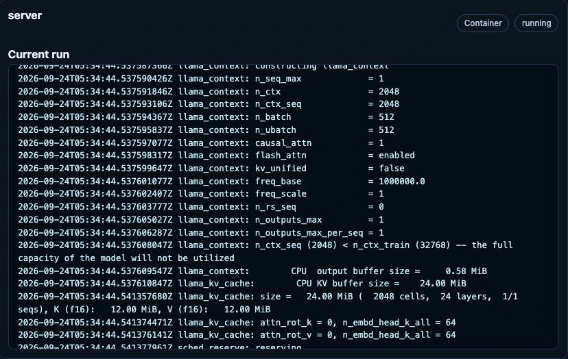

# Model startup and lifecycle

## Read runtime logs in the dashboard

1. Open **Models** and choose **Logs** on the affected model card.
2. Expand its Pod and inspect the relevant container's **Current run**. Previous
   output is also shown when available after a container restart.
3. Read the first actionable error, not only the final readiness timeout. Use
   **Refresh** for another bounded snapshot; this is not a complete log archive.
4. Review any copied output before sharing it. Logs can contain user input,
   credentials or internal addresses.

A model marked `Degraded` / `ModelRuntimeCrashLoop` has restarted unsuccessfully
at least three times, even if Kubernetes still labels its Pod `Running`.
Check the model reference and registry access when this happens during download.
For Ollama, the useful error may be in the Pod's **startup-probe events**, for
example a missing model manifest, rather than the daemon's ordinary log tail.
An OOM failure calls for more RAM or less context/concurrency. A failed image
pull or container configuration calls for checking the image and Pod events.
Retries continue automatically and readiness clears the error; a slow download
without failing containers remains `Starting`. See the
[model controls reference](../../reference/model-controls.md) for exact states.

[](../../assets/screenshots/model-logs.webp)

*Live excerpt from the owner-authorized CPU test model, 24 September 2026. This
healthy initialization example shows where to inspect output, not an error or a
performance benchmark. Pod/host details, internal addresses and input content
are outside the crop.*

## Unsupported model architecture or quantization

An error such as `Transformers does not recognize model type` occurs before
weight loading and inference. Compare the model repository's `config.json`
with the **actual image version** in its Pod. Clearing the model cache or
adding GPUs does not install a missing architecture. HF-token warnings are
separate unless registry access itself fails.

Ordinary Magic Stick vLLM images are pinned to upstream 0.31.0. Its releases
include Qwen3.8-Flash-Next (`qwen4_exp`), unlike the older 0.23.0 NVIDIA image.
Architecture support and quantization support are different checks:
`local-inference-lab/Qwen3.8-Flash-Next-NVFP4` also packs the PLE n-gram tables
as NVFP4. The standard 0.31.0 PLE implementation has unquantized and FP8 paths;
do not treat its model registration as proof that this packed layout works.
The model publisher's recorded run uses a custom vLLM build on RTX PRO 6000
Blackwell hardware, not acceptance of the standard image on RTX A6000.
Sources: [vLLM 0.29.0 model support](https://github.com/vllm-project/vllm/releases/tag/v0.29.0),
[0.31.0 PLE implementation](https://github.com/vllm-project/vllm/blob/v0.31.0/vllm/models/qwen4_exp/common/ngram_embedding.py),
[checkpoint requirements](https://huggingface.co/local-inference-lab/Qwen3.8-Flash-Next-NVFP4#requirements)
and [publisher benchmark](https://docker.local-inference-lab.ai/bench/runs/USvrexyRIajb).

Use a checkpoint/quantization supported by the selected runtime and GPUs, or
qualify a separately reviewed runtime for that format. Do not blindly enable
`trust_remote_code`, change weight files or replace the image with `latest`.
Check every selected GPU; successful DRA allocation alone is not inference.

If an official FP8 Flash-Next checkpoint loads its weights but warmup reports
`fp8e4nv not supported in this architecture` in
`_lookup_ple_embedding_from_pinned_kernel`, the 0.31.0 pinned-host PLE lookup is
another boundary. This is not necessarily the KV cache or an incomplete
download. Upstream [fix #60142](https://github.com/vllm-project/vllm/commit/b0b23a48d466712d18d390e73b62b169842f65e2)
copies those FP8 storage bytes without requiring native SM89 FP8 instructions.
Re-pulling the unchanged 0.31.0 image, clearing the cache or adding RAM does not
include that later fix. An administrator can qualify the
[explicit, checksum-bound backport](../../development/model-integration.md#ordinary-vllm-runtime-upgrades)
or a separately reviewed upstream image. It is not automatically enabled and
does not establish support for other packed PLE formats or every GPU/model.

A subsequent error in `_qsa_sparse_paged_gqa_splitk_kernel` can have the same
FP8 dtype message but a different cause: the explicitly selected **FP8 KV
Cache** path. On the qualified RTX A6000 trial, **KV Cache → Standard - model
precision** resolved this second failure. The checkpoint weights stayed FP8;
the native cache used model precision. Do not assume that fixing PLE lookup also
qualifies every FP8 attention/cache kernel on older GPUs.

## Multi-GPU communication or host-memory failures

A split model can receive every requested DRA claim and still hang before
weight loading in NCCL. Compare the actual selected pair, topology and runtime
logs; successful inference on four cards does not certify every two-card pair.
The wrapper checks a split group's exact UUIDs with bounded native all-reduce
and send/receive probes. When default transport fails and host-mediated transport
passes, its startup log states that the Pod uses `NCCL_P2P_DISABLE=1` and disabled
custom all-reduce. This may reduce throughput. If both checks fail, inspect
PCIe/IOMMU topology and the retained Pod diagnostics. Operator-supplied transport
settings are preserved; host configuration is not modified by these probes.
See [NVIDIA's GPU communication troubleshooting](https://docs.nvidia.com/deeplearning/nccl/user-guide/docs/troubleshooting/gpu_troubleshooting.html).

`OOMKilled` is a different failure. Inspect the **actual Pod RAM limit**, not
only available VRAM or the number of GPU claims. Architecture registration and
valid FP8 arguments do not prove that model initialization, implicit CPU-resident
tables or a community checkpoint's packed weight layout fit that limit. Stop
repeated failures while qualifying the checkpoint and its RAM requirements;
keep the saved definition/cache and do not assume that simply increasing the
limit will make an unqualified format work.

## Stop and resume models

In **Models → Installed Models**, operators and administrators can use **Stop**
for Ollama, vLLM (including Realtime). This interrupts local inference and removes the
model's runtime without deleting its saved model definition or settings. Wait
for stopping to finish, then use **Start** to deploy the same configuration again.
GPU slots and CPU/GPU memory become available as the runtime Pods and allocations
are released, not necessarily as soon as the button is pressed. Starting again
can wait for capacity or download/initialization work; inspect the status and
**Logs** if needed.


## Model Catalog

For a model blocked by `Insufficient cpu`, compare Pod **requests** with the
node's **allocatable** CPU, not just `kubectl top` usage. The model status now
includes `PodScheduled=False/Unschedulable` details. Automatic CPU requests
are independent of RAM/VRAM; the defaults and override fields are documented
in [CPU scheduling policy](../../reference/compute-targets.md#cpu-scheduling-policy).
After upgrading, confirm `status.cpuResources`, the final KubeAI count-one
resource profile and the Pod's actual requests/limits. Existing Pods are
replaced as the policy changes. Keep the host/Kubernetes reserve; do not
increase allocatable CPU to disguise excessive model requests. Check CPU use,
throttling and inference latency under real load before reducing requests
further or increasing a CPU-inference limit.

```bash
kubectl -n ai get configmap ai-model-catalog \
  -o jsonpath='{.data.AI_APPLIANCE_MODEL_CATALOG_READY}{"\n"}{.data.AI_APPLIANCE_MODEL_CATALOG_HASH}{"\n"}'

kubectl -n ai logs deploy/ai-model-catalog-controller
```

For schema details and model troubleshooting, see
[model-catalog.md](../../concepts/model-routing.md).

For a multimodal vLLM model that fails during vision-encoder profiling, inspect
the model Pod logs for the selected ViT backend and SDPA kernel warnings. A
large temporary attention allocation is distinct from the model's KV cache or
CPU scheduling request. On AMD, **Edit → Advanced → Deployment → Vision
attention backend** selects the alternatives documented in
[vision attention deployment](../../reference/compute-targets.md#vllm-vision-attention-deployment).
After an intentional change, verify the generated KubeAI Model args/env and
the new Pod's logs, then test both text and representative image requests.
Keep context and memory budgets fixed when comparing backends. Check actual
peak memory and output correctness; Ready alone is insufficient. Explicit
**Automatic** removes the managed manual overrides; it may restore the same
SDPA fallback that caused the original failure. Do not automatically switch
all existing models or treat an untested backend as a capacity guarantee.

## Operations

Inspect generated catalog status:

```bash
kubectl -n ai get configmap ai-model-catalog \
  -o jsonpath='{.data.AI_APPLIANCE_MODEL_CATALOG_READY}{"\n"}{.data.AI_APPLIANCE_MODEL_CATALOG_HASH}{"\n"}'
```

View available chat models:

```bash
kubectl -n ai get configmap ai-model-catalog \
  -o jsonpath='{.data.chat-models\.json}' | jq .
```

Check controller logs:

```bash
kubectl -n ai logs deploy/ai-model-catalog-controller
```

Common failure modes:

| Symptom | Check |
|---|---|
| `AI_APPLIANCE_MODEL_CATALOG_READY=false` | Controller has not completed a successful reconcile; check controller logs and LiteLLM reachability. |
| External model missing | Confirm `ai-external-models.data["models.json"]` is valid JSON and the entry is not `enabled: false`. |
| Default model is empty or unexpected | Confirm the requested default id exists and has the expected `chat` or `embedding` type. |
| Consumer app still uses old model data | Confirm the pod has the consumer label or annotation, or restart the app after the catalog hash changes. |
| Secret-backed external model fails | Confirm the referenced Secret and key exist in namespace `ai`; the controller needs to read the Secret value to sync LiteLLM. |
