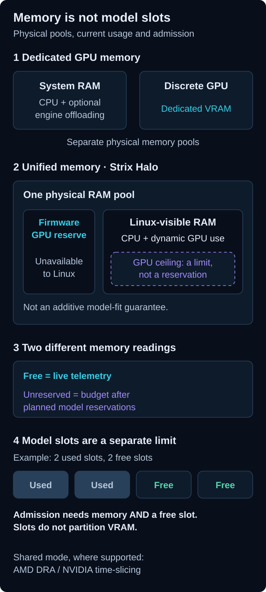

# Memory and resource accounting

[](../assets/diagrams/memory-and-sharing.svg)

*Conceptual layout, not to scale. The four model slots are an illustration, not
a default or a hardware recommendation. Open the diagram for full-size labels.*

## Capacity, free memory and unreserved budget

- **Capacity** describes a device or memory pool reported by the host/driver.
- **Free** is current telemetry. Another process can change it immediately.
- **Unreserved** subtracts planned model reservations. It is scheduling/accounting
  information, not proof that physical memory is unused.
- **Slots** count admitted models. They are independent of bytes and are not GPUs.

A model can be blocked by either a full slot budget or insufficient usable memory.
Its download and startup also need disk and CPU resources. Stopping a model releases
resources only when its runtime and allocations have actually terminated.

## Dedicated and shared GPU memory

A discrete GPU usually has dedicated VRAM. On a unified-memory system such as
Strix Halo, firmware-reserved GPU memory is unavailable to Linux, while dynamic GPU
allocations use Linux-visible RAM. The dynamic ceiling is an upper bound, not RAM
protected from CPU processes.

The shared-free estimate must respect both limits:

```text
shared free = max(0, min(Linux MemAvailable, shared ceiling - GPU occupancy))
```

If usable GPU occupancy telemetry is unknown, the dashboard must not claim that
the entire shared ceiling is free. Firmware and dynamic pools are not two GPU
deployment targets and cannot be blindly summed into a model-fit guarantee.

## Engine budgets

vLLM/Ollama memory estimates include model and context/runtime assumptions.
Supported CPU offloading uses host RAM on the selected GPU node, not memory from
another node or an implicit disk-swap pool. GPU budgets are not universal
hardware-enforced VRAM partitions.

Splitting one model across several GPUs and replicating it are different budgets.
Splitting estimates a portion of the weights on each card and reserves one host
Pod's RAM/CPU. Replication keeps a full model copy on every selected card and
reserves RAM/CPU separately for each copy. Adding copies increases concurrent
serving capacity; it does not lower the VRAM needed by a copy. Both modes consume
one slot on each selected card, not on unselected GPUs.

For a split model, the dashboard's memory control shows the total VRAM budget
across the selected cards and divides it equally when saving. Its 100% maximum
is the GPU count times the least unreserved card's budget, rounded down to
100 MiB per card. It does not pool RAM from other nodes or let a larger card
cover another card's missing capacity. Replicated copies retain a full budget
per copy. Saved settings and capacity checks remain per GPU in both modes.

The split-model calculator and its Breakdown use the same group totals for
weights, cache, runtime reserve and headroom. Explanations retain the per-card
formula and show how the total is derived. Download bytes stay a storage/network
quantity; one split Pod's host runtime reserve is counted once. Compact GiB
labels are rounded for display; the explanations show exact MiB values.

vLLM cache planning follows tensor ranks or pipeline-local layers. A KV head
may be replicated when there are more tensor ranks than KV heads; MLA latent
cache is also replicated rather than divided as ordinary heads. Recurrent
state and auxiliary QSA caches are separate components. Ollama places whole
layers at load time, so its per-card cache uses an explicitly estimated
uneven-layer envelope, not vLLM's tensor formula. Runtime reserve follows
local shards; uneven placement and recommendation headroom remain separate.
Unknown or unsupported architecture details require runtime validation.

## System RAM for GPU models

GPU inference still needs host RAM. The model form separates **While serving**,
**At startup · estimated range** and a **Conservative recommended budget**.
Serving includes CPU-resident weights/cache, host processes, prompt buffers and
multimodal processor-cache allowances when relevant. Loading adds worker
transfer buffers; the upper envelope also considers checkpoint-backed file
cache that may be charged to the Pod's memory limit. Reclaimable file cache is
not another permanent model copy. Do not add both startup bounds or treat
Ollama's reported model buffers as complete process RSS.

The values are estimates, not measured minimums. A split model has one Pod
budget; replicated copies each need their own host budget. The selected node's
unreserved RAM is not the cluster-wide CPU gauge. Unverified host capacity
stays unknown. Large N-gram/PLE tables are flagged for placement verification:
generic CPU offloading does not establish that a model-specific pinned-host
backend is active.

New multi-GPU/offloading forms propose the conservative RAM recommendation,
bounded by verified node capacity. Saved and manually changed budgets remain
untouched by recalculation. A budget below the provisional startup minimum
requires explicit memory-risk acceptance; verified physical limits still apply.
Single-GPU models without an offloading budget show advisory host estimates and
retain their existing runtime resource profile.

For actions, see [GPU memory](../administration/gpu-memory.md),
[GPU sharing](../administration/gpu-sharing.md) and [engine selection](../user-guide/models/choose-engine.md).
