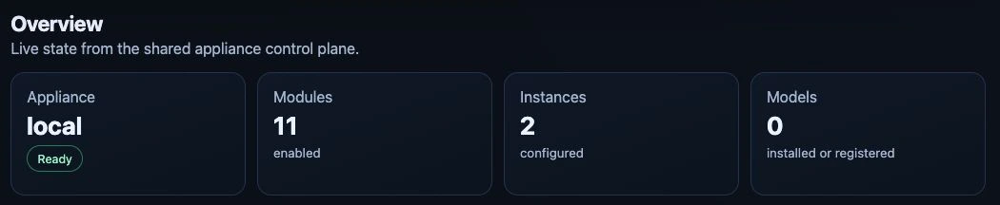

# Dashboard overview

*Overview on the test appliance, captured 24 September 2026. The URL list below
the cards is outside this crop. Select any screenshot to open it at full size.*

## Signing in

On the local Keycloak login page, select **Remember me** only on a trusted,
personal browser. Without it, the session ends after **30 minutes without use**
or **10 hours overall**. With it, the limits are **7 days without use** and
**30 days overall**, including a closed browser or standby. Active use renews
the idle limit, not the overall maximum. Sign out explicitly to end the session.

Access tokens still last five minutes and renew automatically. After this
feature is installed, sign out and sign in once with the checkbox; an existing
browser may still carry the earlier, shorter cookie expiry. Administrator-customized policies and
an external identity provider can impose different limits.

## UI Areas

| Area | Purpose |
|---|---|
| Overview | Shows appliance health, module/instance/model counts, and the complete local, public, or direct URLs discovered for modules and app instances from Ingress, Gateway API `HTTPRoute`, and instance status. |
| Models | Creates and edits Ollama, vLLM and experimental Omni models in one local configuration form with shared CPU controls and engine-specific hardware and memory options. Starts, stops and removes local and external models; discovers Hugging Face repositories and Ollama Library models with selectable artifacts/tags; retains tested presets and direct references; shows per-device memory gauges and bounded runtime logs. |
| Services | Combines modules and instances: application cards contain their instances, shared AI runtime services stay compact, and technical platform modules are collapsed by default. The create dialog first selects an application and then shows only its configuration. |
| API Access | Lets administrators create multiple named LiteLLM API keys, view their non-secret metadata, and revoke individual keys. |
| Mesh | Administrator-only page directly below API Access for Private Mesh setup, membership, invitations, local-model sharing, and relay settings. Existing Settings Mesh links open this page. |
| Kubernetes Access | Lets administrators assign Viewer, Operator, or Cluster Administrator access to existing SSO identities and download or copy token-free OIDC kubeconfigs. |
| System → Settings → Federated SSO | Free Registered or Commercial: validates OIDC discovery or SAML metadata, stores providers in Keycloak, and maps exact upstream claim/attribute values to fixed Magic Stick roles. |
| System | Groups Settings, License, Users, Hardware, System Status, and Computer power behind one primary navigation item. Settings contains the Domains, Federated SSO, Network, and Updates subtabs. System Status contains Overview, GPU Operators, Flux, Network & routes, Model cache, and Regression tests. Administration areas retain their role, identity, and entitlement restrictions; Hardware and the read-only status tabs remain available to every dashboard role. Model cache and Regression tests are administrator-only; Computer power remains an administrator-only System tab immediately after System Status. |

Mesh has a direct link at `#/mesh`. Settings subtabs have direct links at `#/system/settings/<section>`; Domains
is the default at `#/system/settings`. Former `#/system/network` and
`#/system/updates` links redirect to the corresponding Settings subtab. Former
`#/settings/mesh`, `#/system/mesh`, and `#/system/settings/mesh` links redirect to Mesh.
Only the selected subtab mounts its page; opening Settings does not apply
network, update, domain, or identity configuration changes.

## System Status

Open **System → System Status** for a second tab bar, like the one in Settings:

- **Overview** shows resource counts and compact GPU-operator, Flux and route summaries.
- **GPU Operators** shows each provider's driver mode, version, readiness and message.
- **Flux** shows reconciliation state, reasons and messages.
- **Network & routes** shows discovered Gateway routes, hostnames and acceptance.
- **Model cache** and **Regression tests** provide administrator-only maintenance tools.

Overview is the default at `#/system/status`; other tabs use
`#/system/status/<section>`. Existing `#/system/model-cache` and
`#/system/regression` bookmarks redirect to their matching status tab. Opening or
switching tabs does not clear caches, start tests or change system configuration.
Only the selected tool loads its data; status errors do not block access to the
cache or regression page. Use arrow keys, Home and End within the status tab bar.

## Regression tests

On a dedicated disposable test server, open **System → System Status → Regression tests** as an
administrator. **No license is required**, including report downloads.
Enable the optional runner and register the Appliance once, then choose
**Start regression tests**. Choose **Non-destructive only** (default) or
**Include destructive tests**. Non-destructive runs leave existing workloads,
settings, licenses and caches unchanged; they create a temporary viewer account,
runner Job and reports, run isolated checks and read the selected phase's live
inventory. Model lifecycle, inference, sharing, recovery and other mutating live
checks are not run. Excluded steps are listed separately, not passed or blocked.
All phases are selected by default. To run only GPU
tests, choose **Clear selection**, check **Phase 3**, then **Start tests**. You
can also select several phases. The saved selection appears beside progress
and limits the report to those phases.
The suite runs in Kubernetes and survives leaving or reloading the page.
It can stop models and change test-server state; never
register a production Appliance.
This test-server registration is not license activation. License/SSO cases use
test fixtures; missing prerequisites block those checks, not the whole suite.
Runner activation shows an activity bar while sending the request and waiting
for readiness. Image downloads and service startup can take several minutes;
registration becomes available only once the runner is ready. Activation alone
does not start tests.

Every full start cleans up the previous run, checks the baseline, then creates a
fresh test ID and executes the selected tests from the beginning. Earlier results
are never reused. For diagnosis, **Clean up previous test run** performs only
the recorded cleanup, including retained setup access after a lock was released.
Its adjacent status explains whether cleanup is needed, already complete or
blocked by active work or unverifiable ownership.
An active run or unavailable journal disables the button and explains why.
External runs must be recovered from their original runner's private journal.
Non-destructive runs never perform that cleanup automatically: clean up a
previous interrupted run separately first. A successful limited report does not
certify complete phases or real model inference. The saved mode survives reload.

The page shows current phase/check, progress and separate executable-scenario
and case/layer counts. Expand **Failures and blocked checks** for the reason,
phase, variant, check layer, stage, next action and available filtered trace
location. **Blocked by prerequisite** means required hardware, access or fixtures
are unavailable. **Blocked by failure** means an earlier test, preparation or
cleanup failed; its recorded blocking check and trace are shown. Cancelled and
unrecorded causes in older reports remain separate. Missing execution evidence in
a new report is an explicit harness failure. **Download report** saves the full sanitized archive; **HTML summary**
and **JUnit XML** are also available. Cancel requests bounded teardown, not a
claim of successful restoration. See the [short runner guide](../development/regression-remaining-p0.md).
For a failed automatic preparation, the result shows its reason, setup stage
and suggested next action. Separate fixture and live counts make it clear
whether any checks actually ran against this Appliance.
